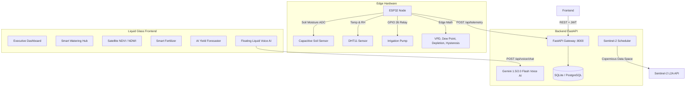

# 🌿 SoilEdge AI Studio Blueprint — Liquid Glass Edition
> **Master Application Prompt & Technical Blueprint for Google AI Studio / Next-Gen App Builders**  
> Use this comprehensive specification to generate, build, or deploy the complete **SoilEdge Smart Agriculture & IoT Field System** with a state-of-the-art **Liquid Glass (Neu-Glassmorphic)** design system.

---

## 📑 Table of Contents
1. [System Overview & Architecture](#1-system-overview--architecture)
2. [Editable Variables & API Credentials Hub](#2-editable-variables--api-credentials-hub)
3. [Liquid Glass Design System Specification](#3-liquid-glass-design-system-specification)
4. [Complete Feature Matrix (Website Parity)](#4-complete-feature-matrix-website-parity)
   - [4.1 Executive Farm Command Dashboard](#41-executive-farm-command-dashboard)
   - [4.2 Smart Watering & Irrigation Hub](#42-smart-watering--irrigation-hub)
   - [4.3 Multispectral Satellite Crop Health (NDVI / NDWI)](#43-multispectral-satellite-crop-health-ndvi--ndwi)
   - [4.4 Smart Fertigation & Nutrition Advisory](#44-smart-fertigation--nutrition-advisory)
   - [4.5 AI Yield Prediction Engine](#45-ai-yield-prediction-engine)
   - [4.6 Multilingual Gemini Voice Assistant](#46-multilingual-gemini-voice-assistant)
   - [4.7 Field Mapping, ESP32 Pairing & Authentication](#47-field-mapping-esp32-pairing--authentication)
5. [Backend API Integration Specification](#5-backend-api-integration-specification)
6. [Ready-to-Use Liquid Glass CSS Tokens & Components](#6-ready-to-use-liquid-glass-css-tokens--components)
7. [AI Studio Generation Prompt (Copy & Paste)](#7-ai-studio-generation-prompt-copy--paste)

---

## 1. System Overview & Architecture

**SoilEdge** is an end-to-end precision agriculture intelligence platform bridging physical IoT field nodes, Copernicus Sentinel-2 satellite observation, on-chip edge analytics, and Google Gemini AI agronomy.



---

## 2. Editable Variables & API Credentials Hub

> 📋 **Copy-Paste Config Block**: Paste your keys and configuration values directly into this JavaScript object when embedding into AI Studio or your frontend environment.

```javascript
// =============================================================================
// SOIL-EDGE SYSTEM CONFIGURATION & CREDENTIALS HUB
// =============================================================================
export const SOIL_EDGE_CONFIG = {
  // --- Network & Backend URLs ---
  BACKEND_BASE_URL: "http://localhost:8000",       // Local Dev: http://localhost:8000 | LAN: http://10.235.221.52:8000
  PRODUCTION_API_URL: "https://api.soiledge.farm", // Set when deploying to production cloud
  WEBSOCKET_TELEMETRY_URL: "ws://localhost:8000/ws/telemetry",

  // --- Authentication Tokens & IDs ---
  USER_JWT_TOKEN: "PASTE_YOUR_USER_JWT_TOKEN_HERE",       // Bearer token from /api/auth/token
  DEVICE_ID: "esp32-01",                                 // Your ESP32 node identifier
  DEVICE_AUTH_TOKEN: "esp32_secret_token_123",           // Device authorization token
  ACTIVE_FIELD_ID: 1,                                    // Default active field ID

  // --- External Cloud & AI API Keys ---
  GEMINI_API_KEY: "PASTE_GOOGLE_GEMINI_API_KEY_HERE",    // For AI Studio Voice Assistant & Crop Advisory
  WEATHER_API_KEY: "PASTE_OPENWEATHERMAP_API_KEY_HERE",  // OpenWeatherMap or WeatherAPI.com
  MAPBOX_ACCESS_TOKEN: "PASTE_MAPBOX_PUBLIC_TOKEN_HERE", // Optional: If using Mapbox GL instead of OSM

  // --- Copernicus Sentinel-2 Satellite Credentials ---
  COPERNICUS_CLIENT_ID: "PASTE_COPERNICUS_CLIENT_ID_HERE",
  COPERNICUS_CLIENT_SECRET: "PASTE_COPERNICUS_SECRET_HERE",
  SENTINEL_REFRESH_INTERVAL_DAYS: 5,

  // --- Edge Agronomic Math & Hardware Calibration ---
  SOIL_SENSOR_DRY_ADC: 3300,  // Sensor in dry air (~3200-3500)
  SOIL_SENSOR_WET_ADC: 1400,  // Sensor submerged in water (~1300-1600)
  
  // --- Smart Hysteresis & Safety Thresholds ---
  IRRIGATION_HYSTERESIS: {
    MOISTURE_LOW_TRIGGER: 25.0,  // Turn ON pump when moisture drops below this %
    MOISTURE_HIGH_TRIGGER: 60.0, // Turn OFF pump when moisture reaches or exceeds this %
    PERMANENT_WILTING_POINT: 15.0, // Critical wilting point for typical loam crops
    MAX_CONTINUOUS_RUN_SEC: 180, // 3 Minutes fail-safe auto-cutout limit
    SAFETY_COOLDOWN_SEC: 600,    // 10 Minutes cooldown lockout after safety cutout
  },

  // --- Vapor Pressure Deficit (VPD) Thresholds (kPa) ---
  VPD_THRESHOLDS: {
    LOW_UNDER_TRANSPIRATION: 0.40, // < 0.4 kPa: High humidity, mold hazard
    OPTIMAL_MIN: 0.40,             // 0.4 - 1.2 kPa: Ideal vegetative growth
    OPTIMAL_MAX: 1.20,
    MILD_STRESS_MAX: 1.60,         // 1.2 - 1.6 kPa: Moderate water pull
    SEVERE_STRESS: 1.60,           // > 1.6 kPa: Stomata close, heat stress
  },

  // --- Default Field Polygon (GeoJSON format: [Longitude, Latitude]) ---
  DEFAULT_FIELD_GEOJSON: {
    type: "Polygon",
    coordinates: [[
      [73.8567, 18.5204],
      [73.8580, 18.5204],
      [73.8580, 18.5215],
      [73.8567, 18.5215],
      [73.8567, 18.5204]
    ]]
  }
};
```

---

## 3. Liquid Glass Design System Specification

The application must implement a **Liquid Glass (Neu-Glassmorphic)** aesthetic. It feels fluid, ultra-modern, luminous, and tactile.

### Core Visual Principles
1. **Glassmorphic Multi-Layering**:
   - Translucent frosted glass layers with `backdrop-filter: blur(20px) saturate(190%)`.
   - Subtle specular highlight border: `1px solid rgba(255, 255, 255, 0.12)`.
   - Dynamic soft shadows with colored glow falloffs: `box-shadow: 0 8px 32px 0 rgba(0, 0, 0, 0.37), inset 0 0 1px 1px rgba(255, 255, 255, 0.1)`.
2. **Deep Obsidian & Fluid Mesh Background**:
   - Canvas background: Dark slate `#080d19` with ambient, animated radial gradient meshes (`#059669` emerald glow, `#0284c7` sky cyan glow, `#4f46e5` deep indigo).
3. **Chromatic & Iridescent Accents**:
   - **Emerald Vitality**: `#10b981` / `#34d399` (Healthy crops, optimal moisture, active pumps).
   - **Cyber Cyan**: `#06b6d4` / `#38bdf8` (Atmospheric humidity, NDWI water canopy, live sync).
   - **Radiant Amber**: `#f59e0b` / `#fbbf24` (Transpiration stress, wilting warnings, soil drying).
   - **Neon Rose / Coral**: `#f43f5e` / `#ef4444` (Fungal spore alert, safety cutout lockout).
4. **Organic Fluid Components**:
   - Rounded corners: `border-radius: 20px` on cards, `9999px` on floating pills and action docks.
   - Interactive hover transitions: `transform: translateY(-3px) scale(1.01)`, dynamic border illumination.
   - Fluid wave animations for soil moisture meters and liquid fill indicators.

---

## 4. Complete Feature Matrix (Website Parity)

The generated app must contain **every single feature** currently present across all SoilEdge website modules:

### 4.1 Executive Farm Command Dashboard
* **Field Switcher Dock**: Dropdown / pill selector allowing instant switching between registered farm plots (Field 1: North Plot, Field 2: Vineyard, etc.).
* **Live IoT Telemetry Cards (Soil Moisture + DHT11)**:
  * **Soil Moisture Card**: Live % value, circular or horizontal liquid progress wave, raw ADC display, sensor voltage (0–3.3V).
  * **Microclimate Card**: Ambient Temperature (°C) and Relative Humidity (%) with real-time comfortable range gauge.
  * **Vapor Pressure Deficit (VPD) Card**: Real-time calculated kPa with transpirational status badge (*Optimal*, *Under-transpiration*, *Severe Stress*).
  * **Dew Point & Fungal Disease Risk Card**: Magnus calculated $T_{dew}$, condensation margin $(T - T_{dew})$, risk classification (*LOW*, *MODERATE*, *HIGH Mold Alert*).
  * **Soil Depletion Rate Card**: Rolling moisture loss rate ($\Delta M / \Delta t$ in %/hr) with estimated hours remaining before the **15% crop wilting point**.
* **Live Actuator Dock (Smart Pump Remote Control)**:
  * Pump State: Glowing green `RUNNING` or grey `IDLE`.
  * Mode Switch: Toggle between `AUTOMATIC (Hysteresis)` and `MANUAL OVERRIDE`.
  * Manual Pulse Button: Trigger a 60-second watering pulse directly from UI.
  * Fail-Safe Cutout Banner: Shows countdown timer or red `LOCKOUT ENGAGED` if run timer exceeded 3 minutes.
* **Interactive GIS Map Component**:
  * Leaflet / Mapbox map displaying the farm boundary polygon in glowing emerald glass lines.
  * Node pin showing ESP32 status (Online / Last Seen pulse).
  * Satellite layer toggle: Normal Satellite vs. False-Color NDVI Overlay.
* **Microclimate Forecast Widget**: 7-day temperature, rainfall probability, and ET (evapotranspiration) outlook.
* **Live Automation Event Stream**: Real-time feed showing system actions (*"Pump started: Moisture dropped to 23.4%"*, *"Target reached: 60.1% pump stopped"*).

---

### 4.2 Smart Watering & Irrigation Hub
* **Hysteresis Dual-Threshold Controller**:
  * Visual dual-slider allowing farmers to customize the **Turn-ON limit** (e.g. 25%) and **Turn-OFF target** (e.g. 60%).
  * Real-time diagram illustrating hysteresis gap to explain how relay chatter is prevented.
* **Fail-Safe Safety Protection Panel**:
  * **Continuous Run Limiter**: Configurable cutoff timer (default 3 minutes).
  * **Cooldown Period**: 10-minute lockout timer to prevent motor overheating.
  * Manual Reset button to clear safety lockouts.
* **Soil Depletion & Wilting Simulator**:
  * Interactive graph showing moisture trend curve dipping toward the permanent wilting threshold.
  * Weather-adjusted moisture forecast (factors in ambient humidity, temperature, and VPD).
* **Volumetric Water Analytics**: Daily and weekly liters consumed, estimated cost savings compared to traditional flood irrigation.

---

### 4.3 Multispectral Satellite Crop Health (NDVI / NDWI)
* **Sentinel-2 L2A Ingestion Engine**:
  * Displays latest satellite acquisition date and cloud cover percentage.
  * Multi-band formula calculation:
    $$\text{NDVI} = \frac{\text{B08 (NIR)} - \text{B04 (Red)}}{\text{B08 (NIR)} + \text{B04 (Red)}}$$
    $$\text{NDWI} = \frac{\text{B08 (NIR)} - \text{B11 (SWIR)}}{\text{B08 (NIR)} + \text{B11 (SWIR)}}$$
* **Interactive Heatmaps**:
  * 5-Class NDVI Color Gradient:
    * `0.00 – 0.20`: Bare Soil / Rocks (Red/Brown)
    * `0.20 – 0.40`: Sparse / Stressed Vegetation (Amber)
    * `0.40 – 0.60`: Moderate Health (Yellow-Green)
    * `0.60 – 0.80`: Dense Healthy Canopy (Emerald Green)
    * `0.80 – 1.00`: Peak Biomass Vigor (Deep Vibrant Green)
* **NDWI Canopy Water Stress Map**: Blue-spectrum heatmap detecting internal leaf dehydration before physical wilting occurs.
* **Health Summary Index**: Overall field score (0–100) combining satellite NDVI and IoT ground moisture.

---

### 4.4 Smart Fertigation & Nutrition Advisory
* **Crop Growth Stage Tracker**: Select active crop (Wheat, Cotton, Rice, Maize, Tomato, Sugarcane) and vegetative stage (Seedling, Vegetative, Flowering, Yield Formation).
* **Soil Nutrition Status**:
  * Soil Moisture Availability Index.
  * Climate Transpiration Index (VPD based nutrient uptake capacity).
* **Targeted Fertigation Recommendations**:
  * Recommended N-P-K nutrient ratios tailored to current stage.
  * Recommended liquid organic fertilizer recipes (e.g., Jeevamrutha, seaweed extract).
  * Solenoid valve pulse scheduler (micro-fertigation pulses to prevent root burn).

---

### 4.5 AI Yield Prediction Engine
* **Harvest Yield Forecaster**:
  * Projects estimated yield in **Quintals per Hectare** or **Tons per Acre**.
  * Dynamic confidence interval bar (e.g. $42.5 \pm 3.2$ Q/Ha with 92% confidence).
* **Contributing Factor Breakdown**:
  * Weighted contribution chart: Satellite NDVI Biomass (40%), Soil Moisture Consistency (35%), Microclimate VPD Stress Days (25%).
* **Historical Benchmark Comparison**: Side-by-side comparison against regional average and previous season yields.
* **Yield Loss Mitigation Recommendations**: Actionable suggestions to boost yield before harvest window closes.

---

### 4.6 Multilingual Gemini Voice Assistant
* **Floating Liquid Glass Voice Widget**:
  * Accessible from any page via a floating glowing orb in the bottom-right corner.
  * Expands into an iridescent glass modal with animated voice waveform.
* **Multilingual Speech & Text**:
  * Supports English, Hindi (हिंदी), Marathi (मराठी), Gujarati (ગુજરાતી), and regional agrarian dialects.
  * Voice recording via Web Speech API / MediaRecorder + native browser Text-to-Speech audio reply.
* **Full Context-Aware AI Grounding**:
  * Automatically injects current field telemetry into Gemini prompt:
    * Current Soil Moisture, Temperature, Humidity, VPD, Dew Point.
    * Latest Pump Status and Hysteresis mode.
    * Latest Sentinel NDVI score.
  * Sample Queries Handled:
    * *"Why is the water pump running right now?"*
    * *"Is my wheat crop experiencing fungal risk?"*
    * *"How many hours until my soil reaches wilting point?"*
    * *"What is my predicted harvest yield?"*

---

### 4.7 Field Mapping, ESP32 Pairing & Authentication
* **JWT User Authentication**: Sleek liquid glass login and registration modal with password hashing and JWT token storage.
* **Field Boundary Polygon Creator**:
  * Interactive map tool to draw field boundaries by clicking vertices.
  * GeoJSON export and import support.
* **ESP32 Node Device Pairing**:
  * Form to register a new hardware device ID (e.g., `esp32-01`).
  * Generates secret device token with one-click copy button for Arduino IDE sketch configuration.

---

## 5. Backend API Integration Specification (Verified APK & Web Endpoints)

The mobile APK and web client communicate with the FastAPI backend using standard REST endpoints:

### Complete Endpoint Directory for Mobile APK

| Method | Exact Endpoint Path | Purpose / Description | Headers / Auth |
|---|---|---|---|
| `GET` | `/api/health` | Backend liveness probe & DB connection check | None |
| `POST` | `/api/auth/register` | Register new user (`email`, `password`, `full_name`) | `Content-Type: application/json` |
| `POST` | `/api/auth/login-json` | Mobile JSON login (`email`, `password`) $\rightarrow$ returns JWT `access_token` | `Content-Type: application/json` |
| `POST` | `/api/auth/login` | OAuth2 form login (`username`, `password`) | `application/x-www-form-urlencoded` |
| `GET` | `/api/auth/me` | Fetch authenticated farmer profile | `Authorization: Bearer <token>` |
| `GET` | `/api/fields` | List all registered fields with last event & device status | `Authorization: Bearer <token>` |
| `POST` | `/api/fields` | Create new field with GeoJSON polygon (`name`, `crop_type`, `polygon`) | `Authorization: Bearer <token>` |
| `GET` | `/api/fields/{field_id}` | Fetch field metadata & boundary details | `Authorization: Bearer <token>` |
| `DELETE` | `/api/fields/{field_id}` | Delete a field | `Authorization: Bearer <token>` |
| `GET` | `/api/fields/{field_id}/readings/latest` | **Latest live sensor telemetry** (`moisture`, `temp`, `humidity`) | `Authorization: Bearer <token>` |
| `GET` | `/api/fields/{field_id}/readings` | Historical telemetry series (Query: `?limit=500&from=...&to=...`) | `Authorization: Bearer <token>` |
| `GET` | `/api/fields/{field_id}/events` | Automation events & pump history (Query: `?limit=200`) | `Authorization: Bearer <token>` |
| `GET` | `/api/fields/{field_id}/health` | **Combined Health Score**, status verdict & soil moisture context | `Authorization: Bearer <token>` |
| `GET` | `/api/fields/{field_id}/satellite` | Sentinel-2 multispectral NDVI/NDWI observations list | `Authorization: Bearer <token>` |
| `GET` | `/api/fields/{field_id}/health/trend` | Historical health scores & NDVI trends for charting | `Authorization: Bearer <token>` |
| `POST` | `/api/fields/{field_id}/satellite/refresh`| Trigger on-demand Sentinel-2 satellite observation pull | `Authorization: Bearer <token>` |
| `POST` | `/api/devices/register` | Register ESP32 field node (`device_id`, `field_id`, `name`) | `Authorization: Bearer <token>` |
| `GET` | `/api/devices` | List registered ESP32 nodes and online status | `Authorization: Bearer <token>` |
| `POST` | `/api/telemetry` | ESP32 hardware telemetry ingestion | `Authorization: Bearer <device_token>` |
| `POST` | `/api/voice/chat` | Multilingual Gemini Voice Assistant query (`text`, `field_id`) | `Authorization: Bearer <token>` (optional) |
| `GET` | `/api/model/info` | Edge Decision Tree AI metadata & accuracy report | `Authorization: Bearer <token>` |
| `POST` | `/api/model/score` | Re-score moisture & temp on server (`moisture`, `temperature`) | `Authorization: Bearer <token>` |

---

### 📱 Android APK Networking & Setup Rules

When packaging the app into an Android APK (via Flutter, React Native, Capacitor, or WebView wrapper), note these critical requirements:

1. **Host Address Configuration**:
   * **Android Emulator**: Use `http://10.0.2.2:8000` (points to the developer host PC).
   * **Physical Android Device (Wi-Fi)**: Use your local IP: `http://10.235.221.52:8000` (ensure PC firewall allows incoming traffic on port 8000).
   * **Production Cloud**: Use `https://your-api-domain.com`.
   * **⚠️ Never use `http://localhost:8000` inside an APK**, because on Android `localhost` refers to the mobile phone itself!

2. **Android Cleartext HTTP Traffic**:
   Because the local development backend uses `http://` (not `https://`), add the following to `android/app/src/main/AndroidManifest.xml`:
   ```xml
   <application
       android:usesCleartextTraffic="true"
       ... >
   ```
3. **Required Android Permissions**:
   ```xml
   <uses-permission android:name="android.permission.INTERNET" />
   <uses-permission android:name="android.permission.ACCESS_NETWORK_STATE" />
   <uses-permission android:name="android.permission.RECORD_AUDIO" /> <!-- For Voice Assistant -->
   ```

### Telemetry Payload Shape (ESP32 $\rightarrow$ Backend)
```json
{
  "device_id": "esp32-01",
  "moisture": 24.5,
  "temperature": 28.4,
  "humidity": 62.0,
  "pump": true,
  "fertilizer": false,
  "action_name": "HYSTERESIS_IRRIGATION_ON",
  "timestamp": "2026-09-10T10:00:00Z"
}
```

### Telemetry Response Shape (Backend $\rightarrow$ Frontend)
```json
{
  "reading": {
    "id": 142,
    "moisture": 24.5,
    "temperature": 28.4,
    "humidity": 62.0,
    "timestamp": "2026-09-10T10:00:00Z",
    "device_id": "esp32-01"
  },
  "event": {
    "id": 89,
    "action_name": "HYSTERESIS_IRRIGATION_ON",
    "pump": true,
    "fertilizer": false,
    "timestamp": "2026-09-10T10:00:00Z"
  }
}
```

---

## 6. Ready-to-Use Liquid Glass CSS Tokens & Components

Inject these CSS tokens into the application's root stylesheet to achieve the authentic Liquid Glass visual finish:

```css
:root {
  /* Canvas & Mesh Palette */
  --bg-canvas: #060a12;
  --bg-gradient: radial-gradient(circle at 20% 15%, rgba(16, 185, 129, 0.12) 0%, transparent 40%),
                 radial-gradient(circle at 80% 80%, rgba(6, 182, 212, 0.10) 0%, transparent 45%),
                 radial-gradient(circle at 50% 50%, rgba(15, 23, 42, 0.95) 0%, #060a12 100%);

  /* Liquid Glass Surfaces */
  --glass-surface: rgba(18, 26, 43, 0.60);
  --glass-surface-hover: rgba(28, 39, 64, 0.75);
  --glass-surface-active: rgba(35, 49, 80, 0.85);
  --glass-border: rgba(255, 255, 255, 0.12);
  --glass-border-glow: rgba(56, 189, 248, 0.35);

  /* Shadows & Specular Lights */
  --glass-blur: blur(24px) saturate(190%);
  --glass-shadow: 0 12px 40px 0 rgba(0, 0, 0, 0.45), inset 0 1px 1px 0 rgba(255, 255, 255, 0.15);
  --glass-glow-emerald: 0 0 25px rgba(16, 185, 129, 0.35);
  --glass-glow-cyan: 0 0 25px rgba(6, 182, 212, 0.35);
  --glass-glow-amber: 0 0 25px rgba(245, 158, 11, 0.35);
  --glass-glow-rose: 0 0 25px rgba(244, 63, 94, 0.35);

  /* Functional Accents */
  --accent-emerald: #10b981;
  --accent-cyan: #06b6d4;
  --accent-sky: #38bdf8;
  --accent-amber: #f59e0b;
  --accent-rose: #f43f5e;
  --text-primary: #f8fafc;
  --text-secondary: #94a3b8;
  --text-tertiary: #64748b;
}

/* Base Body Background */
body {
  background: var(--bg-canvas);
  background-image: var(--bg-gradient);
  background-attachment: fixed;
  color: var(--text-primary);
  font-family: -apple-system, BlinkMacSystemFont, "Segoe UI", Roboto, "Inter", sans-serif;
  margin: 0;
  padding: 0;
  min-height: 100vh;
}

/* Master Liquid Glass Card */
.liquid-glass-card {
  background: var(--glass-surface);
  backdrop-filter: var(--glass-blur);
  -webkit-backdrop-filter: var(--glass-blur);
  border: 1px solid var(--glass-border);
  box-shadow: var(--glass-shadow);
  border-radius: 20px;
  padding: 24px;
  transition: all 0.35s cubic-bezier(0.16, 1, 0.3, 1);
  position: relative;
  overflow: hidden;
}

.liquid-glass-card::before {
  content: "";
  position: absolute;
  top: 0;
  left: 0;
  right: 0;
  height: 1px;
  background: linear-gradient(90deg, transparent, rgba(255, 255, 255, 0.35), transparent);
}

.liquid-glass-card:hover {
  background: var(--glass-surface-hover);
  border-color: var(--glass-border-glow);
  transform: translateY(-4px);
  box-shadow: 0 16px 48px 0 rgba(0, 0, 0, 0.55), inset 0 1px 2px 0 rgba(255, 255, 255, 0.25);
}

/* Floating Navigation Dock */
.liquid-dock {
  background: rgba(15, 23, 42, 0.70);
  backdrop-filter: var(--glass-blur);
  border: 1px solid var(--glass-border);
  box-shadow: var(--glass-shadow);
  border-radius: 9999px;
  padding: 8px 16px;
  display: flex;
  align-items: center;
  gap: 8px;
}

/* Status Badges */
.glass-badge {
  display: inline-flex;
  align-items: center;
  gap: 6px;
  padding: 5px 12px;
  border-radius: 9999px;
  font-size: 12px;
  font-weight: 600;
  backdrop-filter: blur(8px);
}

.badge-optimal {
  background: rgba(16, 185, 129, 0.15);
  color: #34d399;
  border: 1px solid rgba(16, 185, 129, 0.3);
  box-shadow: var(--glass-glow-emerald);
}

.badge-warning {
  background: rgba(245, 158, 11, 0.15);
  color: #fbbf24;
  border: 1px solid rgba(245, 158, 11, 0.3);
  box-shadow: var(--glass-glow-amber);
}

.badge-danger {
  background: rgba(244, 63, 94, 0.15);
  color: #f87171;
  border: 1px solid rgba(244, 63, 94, 0.3);
  box-shadow: var(--glass-glow-rose);
}
```

---

## 7. AI Studio Generation Prompt (Copy & Paste)

> 💡 **How to Use**: Copy the prompt below and paste it directly into **Google AI Studio**, **Claude 3.7 Sonnet**, or your preferred AI code builder to generate the full working application!

```text
You are an expert full-stack developer and world-class UI/UX designer.
Create a complete, responsive, single-page application for "SoilEdge" — a next-generation Smart Agriculture & IoT Field Station platform.

AESTHETIC REQUIREMENTS:
- Design System: Ultra-premium "Liquid Glass" (Neu-Glassmorphism).
- Background: Deep obsidian (#060a12) with fluid ambient radiant gradient orbs (#10b981 emerald, #06b6d4 cyan, #4f46e5 indigo).
- Cards: backdrop-filter: blur(24px) saturate(190%), border: 1px solid rgba(255,255,255,0.12), soft inner specular highlight, smooth hover lifts.
- Floating glass dock navigation bar with glowing icons and pill tabs.
- Typography: Clean modern sans-serif (Inter or system-ui), sharp high-contrast numbers, luminous color-coded status badges.

CONFIGURATION & API CREDENTIALS SECTION:
Include a dedicated, fully-editable JS configuration object at the top of the script:
const SOIL_EDGE_CONFIG = {
  BACKEND_BASE_URL: "http://localhost:8000",
  USER_JWT_TOKEN: "YOUR_JWT_TOKEN",
  DEVICE_ID: "esp32-01",
  ACTIVE_FIELD_ID: 1,
  GEMINI_API_KEY: "YOUR_GEMINI_API_KEY",
  IRRIGATION_HYSTERESIS: { MOISTURE_LOW_TRIGGER: 25.0, MOISTURE_HIGH_TRIGGER: 60.0, MAX_CONTINUOUS_RUN_SEC: 180 },
  DEFAULT_FIELD_GEOJSON: { type: "Polygon", coordinates: [[[73.8567, 18.5204], [73.8580, 18.5204], [73.8580, 18.5215], [73.8567, 18.5215], [73.8567, 18.5204]]] }
};

FEATURES TO IMPLEMENT IN TABS/VIEWS:
1. Executive Dashboard:
   - Live Telemetry Cards: Soil Moisture % (with wave animation), Ambient Temp °C, Relative Humidity %.
   - Edge Math Analytics: Vapor Pressure Deficit (VPD in kPa) with stress zone badge, Dew Point (°C) with Fungal Mold alert badge, Soil Depletion Rate (%/hr) and hours to Wilting Point (15%).
   - Actuator Remote Control: Pump status indicator (ON/OFF), Manual Pulse button, Hysteresis Auto-Mode toggle, Fail-Safe 3-minute cutoff indicator.
   - Interactive GIS Field Map: Leaflet map showing field polygon and ESP32 node location.
   - 7-Day Microclimate Weather Forecast widget.
   - Live Automation Activity Feed.

2. Smart Watering Hub:
   - Interactive dual-slider to adjust Hysteresis thresholds (Turn-ON < 25%, Turn-OFF >= 60%).
   - Fail-Safe Cutout Safety Timer and 10-minute cooldown protection display.
   - Dynamic soil moisture depletion curve forecasting exact time to wilting point.
   - Water volume and efficiency savings analytics.

3. Satellite Crop Health (NDVI / NDWI):
   - Sentinel-2 multi-spectral NDVI canopy vigor heatmap (5-zone gradient from bare soil to dense biomass).
   - NDWI canopy moisture stress heatmap.
   - Composite Health Index score (0-100) combining satellite and soil moisture.

4. Smart Fertilizer Advisory:
   - Crop stage selector (Vegetative, Flowering, Fruiting).
   - Custom NPK and organic liquid fertilizer dosage recommendations.

5. AI Yield Prediction Engine:
   - Forecasted harvest yield in Quintals/Hectare with confidence interval.
   - Biomass vs. Moisture vs. Thermal stress impact breakdown.

6. Gemini Multilingual Voice Assistant:
   - Floating liquid glass orb expanding into a voice/chat dialog.
   - Context-grounded query answering (uses live moisture, VPD, pump state in answers).
   - Speech synthesis and voice recording capability.

Make all components fully interactive with mock data fallbacks if the backend is offline, and live API fetch when connected to FastAPI!
```
