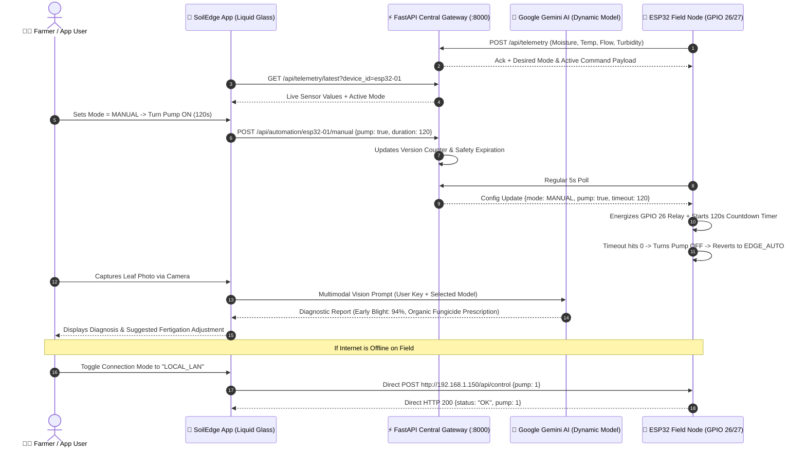

# 🌾 SoilEdge: Complete Precision Agriculture App Creation Guide & Technical Blueprint
> **Version:** 3.0.0 • **Design System:** Liquid Glass (Neu-Glassmorphism) • **Architecture:** Edge-Cloud Synchronized IoT & Multimodal AI  
> **Target Platforms:** Google AI Studio, Next.js / Vite / Vanilla Web, Flutter / React Native, PWA

---

## 📑 Table of Contents
1. [Executive Overview & Capabilities](#1-executive-overview--capabilities)
2. [Editable Variables & Dynamic Configuration Hub](#2-editable-variables--dynamic-configuration-hub)
3. [System Architecture & Communication Flows](#3-system-architecture--communication-flows)
4. [Hardware & ESP32 Integration (Dual-Link Connectivity)](#4-hardware--esp32-integration-dual-link-connectivity)
5. [Automation Engine & 4-Mode Arbitration](#5-automation-engine--4-mode-arbitration)
6. [Dynamic Gemini AI Hub (Voice & Vision Diagnostics)](#6-dynamic-gemini-ai-hub-voice--vision-diagnostics)
7. [Liquid Glass UI Component Specifications & Wireframes](#7-liquid-glass-ui-component-specifications--wireframes)
8. [Backend API Contracts & ESP32 Protocol Schemas](#8-backend-api-contracts--esp32-protocol-schemas)
9. [Master AI Studio / App Generation Prompt (Copy & Paste)](#9-master-ai-studio--app-generation-prompt-copy--paste)

---

## 1. Executive Overview & Capabilities

**SoilEdge (Krishinayan)** is an end-to-end precision agriculture intelligence platform bridging physical IoT field nodes, autonomous edge control, multilingual AI voice agronomy, and multimodal plant vision diagnostics.

### 🌟 Core App Pillars:
1. **Dual-Link ESP32 Connectivity**:
   - **Cloud Link**: Connects to FastAPI Backend via REST & Server-Sent Events (SSE).
   - **Local LAN Link**: Connects directly to the ESP32 IP address (Port 80) when on the same farm Wi-Fi for zero-latency offline control.
2. **Live Automation Inspector**:
   - Real-time gauge telemetry: Capacitive Soil Moisture (%), Air Temp (°C), Humidity (%), VPD (kPa), Turbidity (NTU), Water Flow Rate (L/min), and Session Volume (L).
   - Real-time Actuator Status (Irrigation Pump & Fertigation Valve) with animated fluid dynamics.
3. **Flexible Automation Scheduling & Rule Engine**:
   - **Mode Switcher**: 1-click switching between `EDGE_AUTO`, `SCHEDULED`, `MANUAL`, and `CUSTOM_RULES`.
   - **Scheduler**: Set daily start times, run durations, repeat days, and target actuators.
   - **Custom Rule Studio**: Visual trigger creator (`IF [Sensor] [Condition] [Threshold] THEN [Actuator] [State] for [Duration]`).
4. **Failsafe Edge-First Architecture**:
   - **Default**: ESP32 runs its own autonomous on-chip hysteresis logic (`moisture < 25%` ON, `>= 60%` OFF).
   - **Manual Override**: User can manually trigger pumps/valves with a safety countdown timer (auto-shutoff watchdog).
   - **Offline Auto-Reversion**: If cloud connection drops for >5 minutes, ESP32 safely reverts to `EDGE_AUTO`.
5. **Dynamic Gemini AI Hub (Zero Hardcoding)**:
   - **Manual Model Selection**: User chooses or types any model (e.g., `gemini-2.0-flash`, `gemini-1.5-flash`, `gemini-1.5-pro`, or custom experimental models).
   - **Dynamic API Key**: Input field stored securely in client `localStorage` or environment settings.
   - **Multilingual Voice Agronomist**: Hindi, Marathi, and English voice interaction with real-time farm sensor awareness.
   - **Plant Health Vision Diagnostic**: Live camera snapshot or image upload for instant pest, disease, and nutrient deficiency diagnosis with organic & chemical treatment prescriptions.

---

## 2. Editable Variables & Dynamic Configuration Hub

In your application, all keys, URLs, and model names are dynamically configured through the UI Settings Hub or via this configuration object:

```javascript
// =============================================================================
// SOIL-EDGE DYNAMIC CLIENT CONFIGURATION HUB
// =============================================================================
export const SOIL_EDGE_CONFIG = {
  // --- Network Connection Mode ---
  CONNECTION_MODE: "CLOUD", // Options: "CLOUD" | "LOCAL_LAN"

  // --- Backend Gateway (Cloud Mode) ---
  BACKEND_BASE_URL: "http://localhost:8000",       // Local Dev or LAN IP: http://10.235.221.52:8000
  PRODUCTION_API_URL: "https://api.soiledge.farm", // Deployed Production URL

  // --- Local ESP32 Direct Link (LAN Mode) ---
  ESP32_LOCAL_IP: "http://192.168.1.150",          // Local IP shown in ESP32 Serial Monitor
  ESP32_PORT: 80,

  // --- Hardware Device Identifiers ---
  DEVICE_ID: "esp32-01",
  DEVICE_TOKEN: "esp32_secret_token_123",

  // --- Dynamic Gemini AI Settings (NO HARDCODING) ---
  // Users configure these directly via the in-app Settings Modal
  GEMINI_API_KEY: localStorage.getItem("SOIL_EDGE_GEMINI_KEY") || "",
  GEMINI_MODEL: localStorage.getItem("SOIL_EDGE_GEMINI_MODEL") || "gemini-2.0-flash",

  // --- Supported Gemini Models for Quick Selection ---
  AVAILABLE_MODELS: [
    { id: "gemini-2.0-flash", name: "Gemini 2.0 Flash (Recommended - Fastest)" },
    { id: "gemini-1.5-flash", name: "Gemini 1.5 Flash (Balanced)" },
    { id: "gemini-1.5-pro",   name: "Gemini 1.5 Pro (Deep Agronomic Reasoning)" },
    { id: "custom",           name: "Custom Model (Manual Input)" }
  ],

  // --- Supported Voice Languages ---
  VOICE_LANGUAGES: [
    { code: "hi-IN", label: "हिन्दी (Hindi)" },
    { code: "mr-IN", label: "मराठी (Marathi)" },
    { code: "en-US", label: "English" }
  ]
};
```

---

## 3. System Architecture & Communication Flows



---

## 4. Hardware & ESP32 Integration (Dual-Link Connectivity)

### 4.1 Physical Hardware Pinout
| Pin | Direction | Sensor / Actuator | Operating Parameters |
|---|---|---|---|
| **GPIO 32** | Input (ADC1) | Capacitive Soil Moisture v1.2 | Powered via 2N2222 switch (Dry: ~3300, Wet: ~1400) |
| **GPIO 4** | Input (1-Wire) | DHT11 Air Temperature & Humidity | 0–50°C, 20–90% RH (10k pull-up resistor) |
| **GPIO 34** | Input (ADC1) | Turbidity Sensor (Water Clarity) | Scaled via 10k/5.6k resistor divider (0–3000 NTU) |
| **GPIO 27** | Input (ISR) | Hall-Effect Flow Meter (YF-S201) | Falling-edge pulse ISR ($K = 7.5\text{ pulses/sec} = 1\text{ L/min}$) |
| **GPIO 25** | Output | 2N2222 Transistor Base | Power gating for soil sensor to prevent corrosion |
| **GPIO 26** | Output (Relay)| Submersible 12V Water Pump | Active LOW/HIGH via optocoupled relay channel 1 |
| **GPIO 2** | Output (LED) | Onboard Status Indicator | Blinks on telemetry transmission; solid when pump runs |

### 4.2 ESP32 Local Web API (Port 80)
The ESP32 firmware embeds an asynchronous web server for zero-cloud local LAN interactions:
* `GET /api/status`: Returns `{"moisture": 34.2, "temp": 28.1, "humidity": 65.0, "turbidity": 15, "flow_lpm": 2.4, "pump": 1, "mode": "EDGE_AUTO"}`
* `POST /api/control`: Payload `{"pump": 1, "duration_sec": 120}`
* `POST /api/mode`: Payload `{"mode": "EDGE_AUTO" | "MANUAL" | "SCHEDULED" | "CUSTOM_RULES"}`
* `POST /api/schedule`: Accepts JSON array of time schedules to store in ESP32 RTC/flash memory.

---

## 5. Automation Engine & 4-Mode Arbitration

The app allows complete control over the 4 automation modes while keeping `EDGE_AUTO` as the guaranteed safe default:

```
                      ┌─────────────────────────────────┐
                      │    HARDWARE SAFETY CUTOUTS      │
                      │  • Continuous Run Max: 180 sec  │
                      │  • Post-Cutout Cooldown: 10 min │
                      │  • Salinity/EC Lock: > 2.2 dS/m │
                      └────────────────┬────────────────┘
                                       │
                         Active Control Mode Selected?
         ┌──────────────────┬──────────┴──────────┬──────────────────┐
         ▼                  ▼                     ▼                  ▼
  [1. EDGE_AUTO]       [2. MANUAL]          [3. SCHEDULED]     [4. CUSTOM_RULES]
   (Firmware Default)   User Override        Time Windows       Condition Matcher
         │                  │                     │                  │
   Moisture < 25%:     User toggles Pump     Matches current    Evaluates rule:
     Pump = ON           Runs countdown      NTP time slot?     e.g. Moisture < 30%
   Moisture >= 60%:    Reverts to            Runs duration;     Turns Actuator ON
     Pump = OFF          EDGE_AUTO           Auto-closes        for rule duration
```

### Mode Breakdown:
1. **`EDGE_AUTO` (Default)**:
   - On-chip autonomous closed loop.
   - Soil moisture hysteresis: Starts pumping when moisture drops below **25%**; stops pumping when reaching **60%**.
   - Edge analytics calculates VPD (Vapor Pressure Deficit) and estimated hours to wilting point.
2. **`MANUAL`**:
   - Gives user instant manual ON/OFF buttons for the pump and fertilizer valve.
   - Requires a duration timer (default 180s).
   - Once the timer expires, the pump turns OFF and automatically reverts the mode back to `EDGE_AUTO`.
3. **`SCHEDULED`**:
   - User sets recurring time slots (e.g., Morning Drip at 06:30 AM for 15 minutes on Monday, Wednesday, Friday).
   - ESP32 syncs with NTP time and executes slots autonomously.
4. **`CUSTOM_RULES`**:
   - Dynamic user-defined conditional triggers:
     - *Condition*: `IF [moisture] [<] [28.0]` AND `[temperature] [<] [35.0]`
     - *Action*: `THEN [pump] [ON] for [600 seconds]`

---

## 6. Dynamic Gemini AI Hub (Voice & Vision Diagnostics)

### 6.1 User Settings: Dynamic API Key & Manual Model Selection
To ensure complete flexibility and avoid any hardcoding, the app provides a sleek settings modal:
* **API Key Input**: Text field with mask/unmask toggle (`••••••••`). Saved to `localStorage.getItem("SOIL_EDGE_GEMINI_KEY")`.
* **Model Selection Input**:
  * Dropdown selector with standard models (`gemini-2.0-flash`, `gemini-1.5-flash`, `gemini-1.5-pro`).
  * **Manual Model Input**: Allows typing any arbitrary custom or newly released Google model string (e.g. `gemini-2.5-flash-preview` or `gemini-exp-1206`).
  * Persisted dynamically without modifying app code.

### 6.2 Plant Health & Disease Vision Diagnostic Engine
The app includes a dedicated vision analysis interface:
1. **Input**: User clicks **"Take Photo"** (device camera) or **"Upload Leaf Image"**.
2. **Prompt Strategy**:
   ```javascript
   const VISION_PROMPT = `
   You are Krishinayan's Precision Agronomist AI. Analyze this crop image in detail.
   Current Sensor Context: Soil Moisture: ${moisture}%, Temp: ${temperature}°C, Humidity: ${humidity}%.
   Provide a structured JSON output with:
   {
     "crop_identified": "string",
     "health_status": "Healthy" | "Diseased" | "Pest Infested" | "Nutrient Deficient",
     "primary_diagnosis": "string (name of disease/pest/deficiency)",
     "confidence_percentage": number (0-100),
     "severity": "Low" | "Moderate" | "Critical",
     "visual_symptoms": ["string"],
     "organic_treatment": "string (detailed bio-fertilizer or organic remedy)",
     "chemical_treatment": "string (safe pesticide/fungicide recommendation with dosage)",
     "irrigation_adjustment": "string (e.g., increase watering frequency, stop irrigation to prevent root rot)"
   }`;
   ```
3. **Execution**: Sent directly to `https://generativelanguage.googleapis.com/v1beta/models/${selectedModel}:generateContent?key=${apiKey}` using base64 image data.

### 6.3 Multilingual Gemini Voice Agronomist
1. **Languages**: Instant switch between **Hindi (हिन्दी)**, **Marathi (मराठी)**, and **English**.
2. **Context Injection**: Each voice query injects live ESP32 status into the system prompt:
   - *"Current Farm State: Soil Moisture is 22% (Low), Pump is Running, Turbidity is 14 NTU, Flow Rate is 2.1 L/min."*
3. **Command Recognition**: If the user says *"पानी 10 मिनट के लिए चालू करो"* (Turn on water for 10 minutes), the AI executes an action JSON block:
   ```json
   { "action": "SET_MANUAL_PUMP", "state": true, "duration_sec": 600 }
   ```
   The app immediately updates the backend or local ESP32.

---

## 7. Warm & Clean Dribbble-Grade UI Component Specifications

### 7.1 Design Tokens (Warm Linen & Organic Palette)
```css
:root {
  /* Canvas & Card Surfaces (Dribbble Farhan / Flow Forge Style) */
  --bg-canvas: #FBF9F5;              /* Warm linen / travertine backdrop */
  --bg-card: #FFFFFF;                /* Crisp white floating card */
  --bg-pill-track: #F2EFE9;          /* Soft sand track for toggles */
  --border-card: rgba(231, 239, 233, 0.6);

  /* Organic Botanical Accents */
  --green-organic: #2D6A4F;          /* Deep rich forest green */
  --green-sage: #52B788;             /* Fresh eucalyptus green */
  --green-soft-tint: #E8F5E9;        /* Soft pastel green for badges */
  --warm-terracotta: #D97736;        /* Warm clay / soil accent */
  --amber-sunlight: #F4A261;         /* Warm golden indicator */
  --sky-water: #74C0FC;              /* Gentle blue for irrigation */

  /* Typography */
  --text-headline: #1C1917;          /* Warm espresso slate */
  --text-muted: #78716C;             /* Stone gray */
  --text-faint: #A8A29E;
  --font-family: -apple-system, BlinkMacSystemFont, 'Outfit', 'Inter', sans-serif;
  
  /* Diffuse Multi-Layer Shadows */
  --card-shadow: 0 10px 30px -4px rgba(44, 39, 32, 0.05), 0 2px 6px -1px rgba(44, 39, 32, 0.02);
  --card-shadow-hover: 0 20px 40px -6px rgba(44, 39, 32, 0.08);
  --radius-card: 28px;
  --radius-pill: 9999px;
}
```

### 7.2 UI Layout & Screen Hierarchy
```
┌────────────────────────────────────────────────────────────────────────┐
│  🌾 SOIL-EDGE IoT COMMAND HUB      [🔗 Cloud / 📶 LAN] [⚙️ AI Settings] │
├────────────────────────────────────────────────────────────────────────┤
│ ┌────────────────────────────────────────────────────────────────────┐ │
│ │ 🟢 CONNECTED: esp32-01 | Ping: 42ms | Signal: -58 dBm | Mode: AUTO │ │
│ └────────────────────────────────────────────────────────────────────┘ │
│                                                                        │
│ ┌───────────────────────┐ ┌───────────────────────┐ ┌────────────────┐ │
│ │  💧 SOIL MOISTURE     │ │  🌡️ AIR TEMP & RH     │ │ 🌊 WATER FLOW  │ │
│ │        32.4%          │ │   28.5°C  |  62% RH   │ │   2.35 L/min   │ │
│ │  [Low - Irrigation OK]│ │   VPD: 1.45 kPa       │ │  Session: 4.8L │ │
│ └───────────────────────┘ └───────────────────────┘ └────────────────┘ │
│                                                                        │
│ ┌────────────────────────────────────────────────────────────────────┐ │
│ │ 🎛️ AUTOMATION CONTROL MATRIX                                       │ │
│ │ [● EDGE_AUTO (Default)]  [○ SCHEDULED]  [○ MANUAL]  [○ CUSTOM_RULES]│ │
│ ├────────────────────────────────────────────────────────────────────┤ │
│ │  ⚡ Manual Override Station:                                        │ │
│ │  Pump: [▶ START PUMP (120s)]    Fertilizer: [▶ OPEN VALVE]         │ │
│ │  Safety Cutoff Timer: Active (118s remaining)                       │ │
│ └────────────────────────────────────────────────────────────────────┘ │
│                                                                        │
│ ┌─────────────────────────────────┐ ┌────────────────────────────────┐ │
│ │ 📅 SCHEDULES & CUSTOM RULES     │ │ 🔬 GEMINI VISION PLANT CLINIC  │ │
│ │  • 06:30 AM - Morning Drip (15m)│ │  [📷 Take Photo] [📁 Upload]   │ │
│ │  • 05:00 PM - Fertigation (8m)  │ │  Diagnosis: Healthy (98%)      │ │
│ │  [+ Add New Schedule / Rule]    │ │  Remedy: No action required    │ │
│ └─────────────────────────────────┘ └────────────────────────────────┘ │
│                                                                        │
│                          [ 🎙️ Voice Agronomist (Hindi / Marathi / Eng) ]│
└────────────────────────────────────────────────────────────────────────┘
```

---

## 8. Backend API Contracts & ESP32 Protocol Schemas

### 8.1 Automation Endpoints (`/api/automation`)
```python
# GET /api/automation/{device_id}
Response:
{
  "device_id": "esp32-01",
  "mode": "EDGE_AUTO", # "EDGE_AUTO" | "SCHEDULED" | "MANUAL" | "CUSTOM_RULES"
  "version": 4,
  "manual": {
    "pump": false,
    "fertilizer": false,
    "duration_seconds": 180,
    "expires_at": null
  },
  "schedules": [
    {
      "id": 1,
      "name": "Morning Drip",
      "enabled": true,
      "start_time": "06:30",
      "duration_minutes": 15,
      "days_of_week": ["MON", "WED", "FRI"],
      "target_actuator": "pump"
    }
  ],
  "custom_rules": [
    {
      "id": 1,
      "name": "Dry Soil Guard",
      "enabled": true,
      "trigger_sensor": "moisture",
      "operator": "<",
      "threshold_value": 25.0,
      "action_actuator": "pump",
      "action_state": true,
      "duration_seconds": 300
    }
  ]
}
```

### 8.2 Telemetry Piggyback Payload (`POST /api/telemetry`)
When ESP32 transmits telemetry every 5 seconds, the response contains the desired automation commands:
```json
{
  "ok": true,
  "reading_id": 9210,
  "field_id": 1,
  "config": {
    "version": 4,
    "mode": "EDGE_AUTO",
    "commands": {
      "pump": false,
      "fertilizer": false,
      "max_runtime_sec": 180
    }
  }
}
```

---

## 9. Master AI Studio / App Generation Prompt (Copy & Paste)

> 📋 **Instructions**: Copy the entire prompt block below and paste it directly into **Google AI Studio**, **Claude**, **v0.dev**, or any LLM app generator to generate the complete standalone single-file or multi-component SoilEdge application.

```markdown
You are an expert full-stack developer and IoT systems architect.
Build a complete, state-of-the-art Single Page Application (SPA) for "SoilEdge / Krishinayan" precision agriculture and IoT field node management.

### Key Functional Requirements:
1. **Dynamic Gemini AI Hub (Zero Hardcoding)**:
   - Provide an "AI Settings" modal accessible from the top navbar.
   - Include an input field for "Google Gemini API Key" saved in localStorage.
   - Include a "Model Selection" UI featuring a dropdown of popular models (gemini-2.0-flash, gemini-1.5-flash, gemini-1.5-pro) PLUS a manual text input field allowing the user to type ANY custom or newer model string (e.g. gemini-2.5-flash-preview). Never hardcode the model string or API key.
2. **Dual-Link ESP32 Connectivity**:
   - Connection toggle between "Cloud Mode" (FastAPI backend at http://localhost:8000) and "Local LAN Mode" (Direct ESP32 IP at http://192.168.1.150:80).
   - Live connectivity ping badge showing online/offline status, RSSI signal, and last update timestamp.
3. **Real-time Telemetry & Gauge Display**:
   - Circular progress gauges and live trend sparklines for:
     * Soil Moisture (% with Dry/Optimal/Wet zones)
     * Air Temperature (°C) & Relative Humidity (%)
     * Vapor Pressure Deficit (VPD in kPa)
     * Water Flow Rate (L/min) and Total Session Volume (L)
     * Turbidity (NTU)
   - Animated visual indicators for Pump Relay (GPIO 26) and Fertilizer Valve (GPIO 27).
4. **Automation Control Engine (4 Modes)**:
   - 4-way Mode Selector:
     * EDGE_AUTO (Default): Follows on-chip hysteresis (Pump ON < 25%, OFF >= 60%).
     * SCHEDULED: Executes configured timed irrigation slots.
     * MANUAL: User toggles pump/valve with a 180s countdown safety auto-shutoff timer.
     * CUSTOM_RULES: Evaluates user-defined conditional triggers.
   - Interactive Schedule Manager: Add, toggle, edit, or delete scheduled irrigation slots (Time, Duration, Days).
   - Custom Rule Builder: Visual condition creator (IF [sensor] [operator] [value] THEN [actuator] [state] for [seconds]).
5. **Plant Health & Disease Vision Diagnostic**:
   - Camera snapshot button (accessing device camera) and image file upload drag-and-drop.
   - Calls the user-configured Gemini model using the user's API key with multimodal prompt.
   - Renders a diagnosis card: Detected Crop, Disease/Deficiency Name, Confidence Score %, Severity Badge, Symptoms, Organic Remedies, and Recommended Irrigation Adjustments.
6. **Multilingual Gemini Voice Agronomist**:
   - Floating circular microphone button with glowing liquid glass pulse animation.
   - Supports Hindi, Marathi, and English language selector.
   - Speech-to-text / Audio recording feeding the configured Gemini model, preloaded with current farm sensor readings in the system prompt.
   - Can trigger manual pump runs or answer farm queries via voice.

### Visual & Design Requirements:
- Use the **Warm Scandinavian & Organic Dribbble** aesthetic (inspired by modern ceramic and clean agtech lifestyle apps):
  * Warm linen / travertine canvas backdrop (`#FBF9F5`), crisp pure white floating cards (`#FFFFFF`) with generous `28px` rounded corners and diffuse multi-layer ambient drop shadows.
  * Soft earthy palette: rich botanical green (`#2D6A4F`), fresh eucalyptus sage (`#52B788`), warm terracotta (`#D97736`), and sunlight amber (`#F4A261`).
  * No harsh pure black, no dark mode, and no neon cyberpunk glow.
  * Segmented pill tracks (`#F2EFE9`) with smooth floating pill switches for mode selection.
  * Clean typography with warm espresso text (`#1C1917`) and stone gray subtitles (`#78716C`).
- Provide mock telemetry simulation mode if hardware is disconnected, so the app is 100% interactive out-of-the-box.
- Generate clean, modular, production-ready code with complete styling and state management.
```

---

## 10. Summary & Deployment Checklist

To deploy and test your complete SoilEdge system:
1. **Firmware**: Flash `SoilEdge_FieldNode_v3.ino` from `esp32-firmware/SoilEdge_FieldNode_v3/` using Arduino IDE.
2. **Backend**: Run `uvicorn backend.app.main:app --host 0.0.0.0 --port 8000 --reload`.
3. **App**: Open the frontend or feed the AI Studio Prompt into your app generation tool.
4. **AI Setup**: Click the **⚙️ AI Settings** icon in the app, paste your Gemini API key, choose or type your desired model (e.g. `gemini-2.0-flash`), and start automating your farm!
